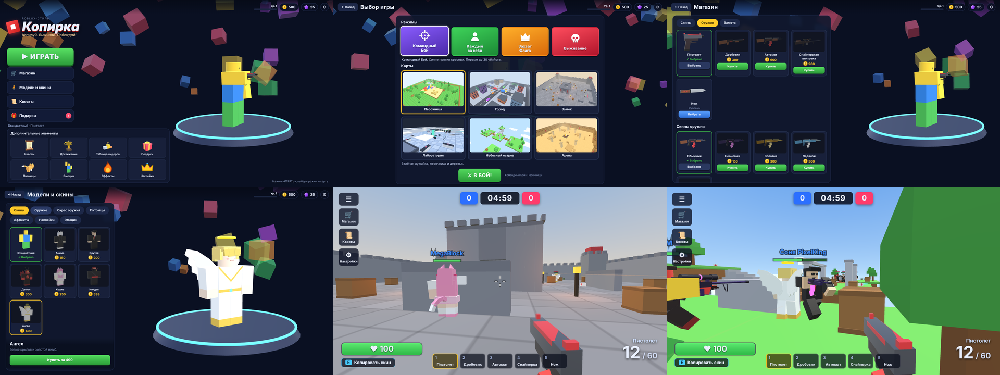
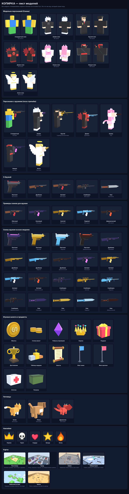

# КОПИРКА — Копируй. Выживай. Побеждай!

Браузерный 3D-шутер в блочном стиле Roblox, собранный по твоему референсу: персонажи (скины), 5 видов оружия с оружейными скинами, 6 карт, 4 режима, магазин, валюта, квесты, питомцы и всё остальное с картинки. **Все модели сделаны кодом из блоков** — никаких готовых ассетов.





## Как запустить

**Самый простой способ** — открыть файл **`dist/kopirka.html`** двойным кликом (работает без сервера и без интернета).

Другие варианты:

```bash
# из исходников (нужен любой статический сервер)
python3 -m http.server 8000      # затем открыть http://localhost:8000
# пересобрать единый файл dist/kopirka.html
npm install && npm run build
```

Нужен современный браузер (Chrome, Edge, Firefox) с WebGL. Играть лучше на компьютере с мышью и клавиатурой.

Быстрый запуск без меню: `index.html?autostart=1&mode=ctf&map=city` (режимы: `tdm`, `ffa`, `ctf`, `survival`; карты: `sandbox`, `city`, `castle`, `lab`, `sky`, `arena`).

## Управление

| Клавиша | Действие |
|---|---|
| W A S D | движение |
| Пробел | прыжок |
| Shift | спринт |
| Мышь / ЛКМ | прицел / огонь |
| ПКМ | прицеливание (у снайперки — оптика) |
| R | перезарядка |
| 1–5 или колесо | смена оружия (Q — предыдущее) |
| **E** | **скопировать скин** игрока, на которого смотришь |
| V | вид от третьего лица |
| Z / X / C / B | эмоции: привет, танец, ура, сила |
| Esc / P | пауза |

## Что внутри

**Скины (модельки персонажей):** Стандартный, Аниме, Крутой, Демон, Кошка + из магазина Ниндзя (399) и Ангел (499). У каждого своё лицо, одежда, волосы/рога/ушки, а у Демона, Ангела — крылья, у Кошки — хвост, у Ниндзя — катана.

**Оружие:** Пистолет, Дробовик, Автомат, Снайперская винтовка, Нож. **Оружейные скины:** Обычный, Неоновый, Золотой, Ледяной, Демонический — работают на всём оружии.

**Карты:** Песочница, Город, Замок, Лаборатория, Небесный остров (батуты, мосты, пропасть), Арена.

**Режимы:**
- **Командный бой** — синие против красных, до 30 убийств;
- **Каждый за себя** — все против всех, до 25 убийств;
- **Захват флага** — укради флаг врага и принеси на свою базу, до 3 захватов;
- **Выживание** — волны копий-клонов с твоим скином.

**Механика «копирки»:** подойди к игроку, посмотри на него и нажми **E** — твой персонаж получит его скин (и оружейный скин). За это дают монеты и засчитывают квест.

**Игра:** монеты за убийства (+10, +5 за выстрел в голову), опыт и уровни, магазин (скины, оружие, оружейные скины, питомцы, эффекты, наклейки), набор монет за робуксы, ежедневные квесты, достижения, таблица лидеров, ежедневный подарок, питомцы (котик, пёсик, дракончик), эффекты убийства, наклейки над головой, эмоции, аптечки и патроны на карте. Прогресс сохраняется в браузере (localStorage).

> Робуксы здесь — **внутриигровая** премиум-валюта (подарки, квесты). Реальных платежей нет.

## Структура проекта

```
index.html, styles.css      страница и оформление интерфейса
models.html                 «Лист моделей» — все модели одной страницей
dist/kopirka.html           готовая игра одним файлом
src/models/characters.js    модели персонажей: 7 скинов, лица, одежда, крылья, анимации
src/models/weapons.js       модели оружия, 5 оружейных скинов, оружие от первого лица
src/models/props.js         монеты, робуксы, подарок, кубок, флаги, аптечки, питомцы, наклейки
src/maps.js                 6 карт из блоков (+ коллайдеры)
src/game.js                 бой: движение, стрельба, боты, режимы, флаги, волны, эффекты
src/menu.js, src/hud.js     меню, магазин, коллекция моделей, HUD, пауза, итоги
src/data.js                 все названия, цены, квесты, достижения
vendor/                     three.js r170 (MIT)
tools/build.mjs             сборка в один файл
```

Открой `models.html` (через локальный сервер, см. выше), чтобы увидеть все модели: скины спереди и сзади, оружие, карты, предметы, питомцы. Готовая картинка — `docs/model-sheet.png`.

## Заметки

- Это **браузерная игра**, а не проект для Roblox Studio. Модели описаны размерами и цветами блоков (1 единица = 1 stud, торс 2×2×1, руки и ноги 1×2×1), так что их удобно перенести в Roblox Parts.
- Боты не используют навигационную сетку: на сложных картах они иногда ходят по прямой и могут застрять — тогда сами выбирают новый маршрут.
- Мобильное управление (касания) не реализовано.
- Тесты проверялись в Chromium (программный рендер). На обычной видеокарте игра идёт гораздо плавнее; при низком FPS отключи тени в «Настройках».
